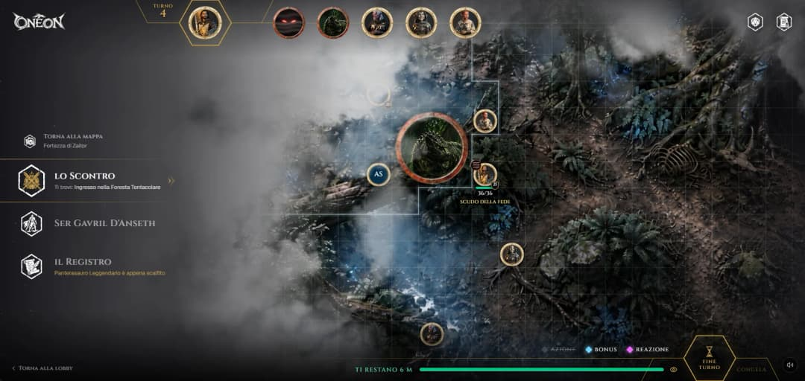
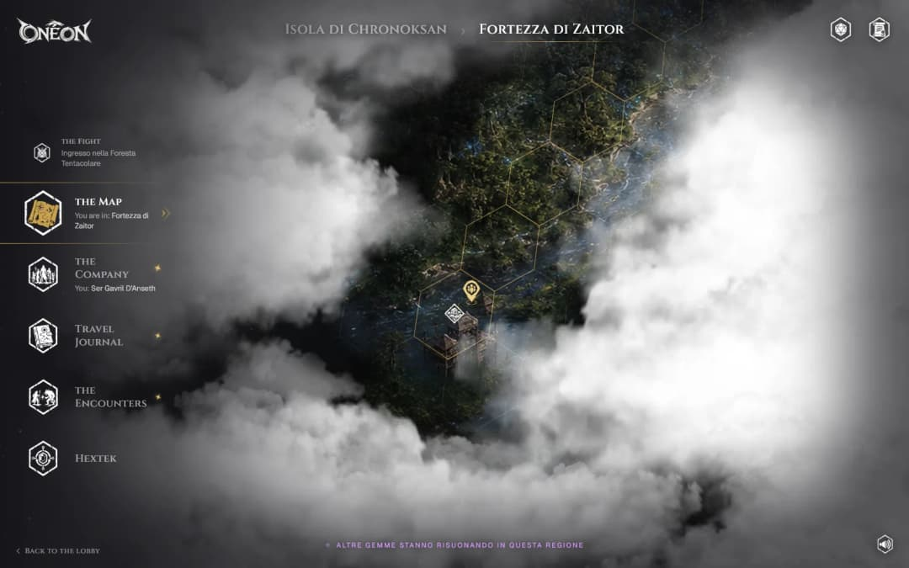
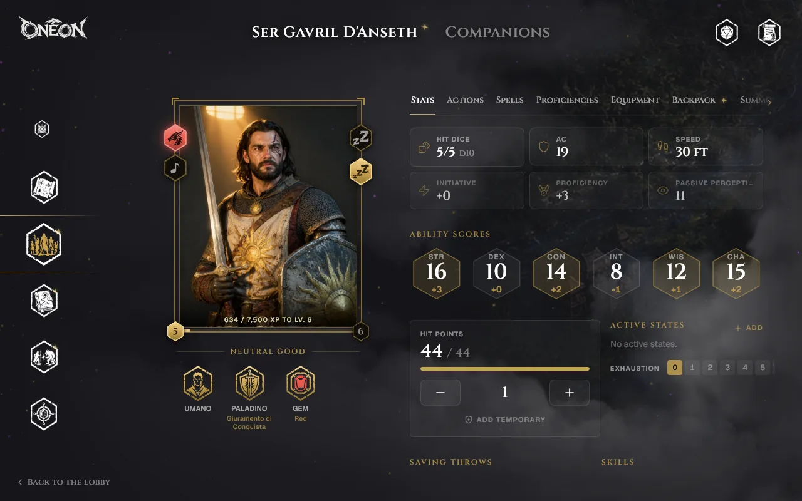
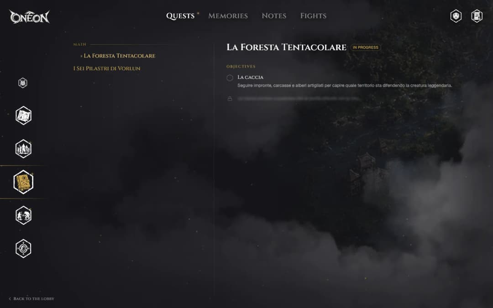

# Game-style UI: план редизайну платформи

Статус: план, нічого не реалізовано. Створено 2026-11-21 за результатами порівняння з oneon.world (скріни їхнього реального продукту: бій, мапа світу, лист персонажа, журнал).

## Мета

Платформа має відчуватися як гра, а не як набір сторінок з панелями: мапа/сцена в центрі, інтерфейс тонкий і з'являється за потреби, одна навігація-«меню гри» на всіх екранах. Конкурент уже має це в альфі; наша перевага (кілька систем правил, конструктор, homebrew, uk/en) втрачає вагу, якщо перше враження гірше.

## Референси

Скріни реального продукту oneon.world (альфа), збережені в `docs/superpowers/plans/assets/2026-11-21-game-style-ui/`. Це внутрішні референси для дизайну, не ассети: не копіювати їхні арт, логотип, іконки та піксельну композицію, брати принципи.

| Файл | Що показує | На що дивитися |
|---|---|---|
| `battle-turn.jpg` | Бій | Мапа на весь екран; ініціатива зверху; дія/бонус/реакція та смуга руху внизу; HP лише біля вибраного жетона; туман як хмари з м'якими краями |
| `world-map.jpg` | Мапа світу | Хмарний туман навколо відкритої області; ліве меню розділів; мінімум UI поверх мапи |
| `character-sheet.webp` | Лист персонажа | Портрет у рамці з кутовими дужками, XP, світогляд, значки раси/класу; плитки Hit Dice/AC/Speed; ряд характеристик; блок HP з ± |
| `journal-quests.jpg` | Журнал | Два стовпці (список квестів, деталі); таби зверху; розмиті заблоковані цілі; багато простору |

Власна мова форм у нас інша: квадрати замість гексів, верхня панель замість лівої колонки (див. рішення нижче).

## Рішення власника (2026-11-21)

- Гекси не використовуємо. Потрібна власна мова форм (див. «Мова форм»).
- Екран бою спрощуємо: бічні сайдбари прибираємо, дані персонажа показуємо бульбашками за кліком, дії виносимо в інше місце, мапа на всю ширину.
- Дальність ходу: замість зелено-червоного агресивного показу, ненав'язлива, але помітна.
- Туман: такий самий за враженням, як у конкурента (хмарний, об'ємний, м'які краї).
- Лист персонажа: за структурою схожий на наданий скрін.
- Головне меню: як меню гри. Усі таби-сторінки стають пунктами меню «куди перейти», а головний вміст тримаємо по центру, у фокусі.
- Весь UI платформи в стилі Game.

Уточнення (2026-11-21, друга відповідь):

- Зараз дальність показується зеленими клітинками біля героя і червоними зонами біля ворогів; ці два кольори прибираємо з агресивного вигляду (Ч3).
- Форми лишаються квадратними (заокруглений квадрат), без гексів і без кіл як основної форми.
- Меню: верхня панель.
- Шрифт: приймається рекомендація (серифний display для заголовків, sans для тексту).
- Арту поки немає; до нього повертаємося в самому кінці (див. «Арт»).
- Світлі палітри: Game-стиль підтримуємо і в них.
- Шрифт: кирилиця і латиниця обов'язково; конкретний вибір робиться в макеті.
- Нижній док дій на phone та інші відкриті деталі вирішуються макетом, а не наперед.
- Мобільна версія: усе, що гравцеві доступне на десктопі, доступне і на мобільному. Це одна з основних особливостей продукту, тому кожна частина закривається на обох екранах разом.
- Обсяг: усе виконується до публічного запуску.

## Принципи

1. **Світ у центрі.** Мапа або сцена займає екран, UI накладається зверху і не конкурує з нею.
2. **Один каркас.** Однакова навігація та тло на всіх екранах кампанії.
3. **Показуй за потреби.** Деталі в бульбашках, шторках та доках за дією, а не постійними колонками.
4. **Мінімум рамок.** Скляні напівпрозорі поверхні, один акцентний колір, багато простору.
5. **Не копіюємо.** Беремо принципи, не їхні арт, логотип, іконки чи піксельну композицію. Ідентичність своя (HUD-естетика вже є основою).
6. **Паритет desktop і mobile.** Усе, що гравець може на десктопі, він може і на телефоні. Частина не закрита, поки не пройдена на обох екранах.
7. **Доступність.** Не кодувати інформацію лише кольором, поважати `prefers-reduced-motion`, перевіряти контраст у всіх палітрах (`PaletteSwitcher`).

## Reuse: що вже є

- Бій: `components/battle/scene/layout/{DesktopBattleLayout,MobileBattleLayout,BattleTopBar,CornerStack,MapStrip}.tsx`. Зараз грід `320px | 1fr | 280px`: ліворуч `MyHeroPanel` + `MyTurnControls` + `DmPanel` + `ReserveGroup`, праворуч `ParticipantDetails` + `BattleLog`; зверху `InitiativeTrack` і `LastActionTicker`.
- Мапа: `components/battle/map/{MapStage,BattleMap,layers,tokens,fog,camera,panels}`; токени мають `MapTokenHud` (авто-приховування HUD уже є, див. map HUD fit).
- Туман: `map/fog/{MapFogLayer (78 рядків),MapFogControls,MapFogToolbar}`, `modes/maze/layers/MazeFogOfWar.tsx`, світ: `components/world/map`.
- Лист: `components/character-profile/{CharacterProfile,tabs,hero,combat,inventory,rest}`; системні блоки листа йдуть через `stats.columns`/`sheet.blocks` (E2), UI систем через `systems/<id>/ui`.
- Журнал/світ: `components/world/{travel,notes,nav,play}`.
- Навігація: `components/layout/Header.tsx` (194 рядки, breadcrumbs + dropdown `dmSectionsFor`), `screen-background.tsx` + `data-screen-bg` у `app/globals.css`.
- Кіт: `components/hud/{page,form}`, `HudButton`, `HudIconButton`, `HudToggleChip`, `ResponsiveDialog`, `QueryState`. Перед написанням нового перевіряти тут (правила `.claude/rules/components.md`, шари `ui → hud → common → domain`).
- FX: Canvas 2D FX, `components/fx`, погода на мапі (`map/weather`).

## Мова форм (замість гексів)

Рішення: **квадрат** лишається основною формою. Заокруглений квадрат із тонкою золотою (акцентною) рамкою для портретів, іконок меню, значків характеристик і кнопок; **кутові дужки** на рамці портрета в листі; жетони на мапі лишаються як у поточній системі. Відрізняємося від конкурента (гекси) формою, а чіткість ієрархії тримаємо розмірами, відступами та одним акцентом.

## Частини

### Ч0. Аудит та дизайн-мова (S, Opus)

- Субагент (Sonnet) у браузері знімає поточні екрани: бій (desktop + phone), мапа світу, лист, журнал, список кампанії, DM-сторінки. Результат: таблиця розривів.
- **Макет перед кодом** (Figma або HTML-прототип): верхня панель меню, бойовий екран (desktop + phone, з бульбашкою, доком дій і шторками), лист персонажа, журнал, один список; темна й мінімум одна світла палітра; порівняння шрифтів на реальних екранах. Код стартує тільки після затвердженого макета.
- Дизайн-токени Game: палітра (темна база, один акцент, бірюзовий для руху), типографіка (серифний display для заголовків із розрідженими літерами + sans для тексту; шрифти self-hosted, `next/font/google` заборонений), радіуси, тіні, скло.
- Перевірка на всіх палітрах. Відомо, що бій на parchment/frost нечитабельний, це треба закрити тут, а не обходити.
- Артефакт: коротка спека токенів і приклади в `components/hud`.

### Ч1. Каркас: меню гри (L)

- Новий компонент оболонки в `components/hud/shell` (рівень `hud`): тло на весь екран (використати `data-screen-bg`), **верхня панель меню** з головними розділами та центральним заголовком сторінки з під-табами.
- Модель: верхня панель = «куди перейти» (Бій, Мапа, Персонажі, Журнал, Сценарій/Показ, DM-розділи); активний розділ виділений, його під-таби під панеллю по центру. Профіль, сповіщення, перемикач палітри та мови справа.
- На phone та вузьких екранах: та сама панель із горизонтальним скролом табів або шторка-меню (`ResponsiveDialog`); усі розділи доступні, нічого не пропадає.
- `Header.tsx` (breadcrumbs, dropdown) замінюється поступово, спершу під прапором на екранах бою/світу/листа.
- Розділи DM беруться з `dmSectionsFor`, пункти залежать від ролі та системи (без `=== "wfrp"`).
- Сторінки-списки та форми: контент по центру в колонці фіксованої ширини, без бічних панелей.
- Частина 1 лише каркас: контент екранів не переписується.

### Ч2. Екран бою (L)

- Мапа на всю ширину та висоту. Прибрати `aside` ліворуч і праворуч з `DesktopBattleLayout`; `MobileBattleLayout` вирівняти під ту саму модель.
- **Бульбашки за кліком по токену:** popover, прив'язаний до токена (герой: HP, ресурси, стани; інший учасник: `ParticipantDetails`). Один відкритий одночасно, закриття за кліком поза або `Esc`. Використати наявний `MapTokenHud` як основу.
- **Дії:** нижній док по центру: індикатори дія/бонус/реакція, смуга залишку руху, кнопка «Кінець ходу». `ActionGrid`/`CoreActionsDialog` відкриваються з дока як радіальне меню або шторка (на phone як bottom sheet через `ResponsiveDialog`).
- **Ініціатива:** лишається зверху (`InitiativeTrack`), компактніше.
- **Лог бою:** зведений до `LastActionTicker` + кнопка-шторка з повним журналом.
- **DM-панель, резерв, баннери:** у шторках за кнопками на краях; не постійні колонки.
- Тулбар мапи (`MapToolsSlot`, погода, фон, камера, міні-мапа): зібрати в одну згорнуту панель.
- Паритет: desktop і mobile робляться разом, одна модель взаємодії (клік/тап по токену = бульбашка, нижній док дій, шторки). Нічого, що гравець робить на десктопі, не зникає на телефоні.
- Пріоритет після Ч1: це найбільший «вау» і матеріал для лендингу.

### Ч3. Дальність ходу (S)

- Зараз: зелені клітинки досяжності біля героя і червоні зони біля ворогів. Рендер у `components/battle/map` явно не знайдено (пошук по `reachable` порожній), швидше за все він у токенах/сітці або в `lib/utils/battle`. Перший крок: локалізувати.
- Новий вигляд: холодна низькоальфа заливка досяжних клітинок і тонкий контур межі; недосяжне просто потемніле. Зони біля ворогів (загроза/атака): не суцільна червона заливка, а тонкий пунктирний контур із легким тоном.
- Інформація не лише кольором: контур + заливка, шлях руху як лінія зі значенням у метрах біля курсору.
- Видно лише для токена в ході або вибраного, плавний fade, `prefers-reduced-motion` без анімації.
- Налаштування контрасту для світлих палітр.

### Ч4. Туман (M, ризик продуктивності)

- Замінити візуал `MapFogLayer`, не логіку видимості (маска, що саме розкрито, лишається). Те саме для світу (`components/world/map`) і лабіринту (`MazeFogOfWar`).
- Реалізація: шар хмарних спрайтів (CC0 текстури через `next/image`), масковані за видимістю з м'яким краєм (feather/blur), повільний дрейф (CSS `transform`/Canvas 2D), анімація розкриття при відкритті нової області.
- Деградація: на слабких пристроях і з `prefers-reduced-motion` статична версія.
- Бюджет: без розширення egress (асети лише один раз, кеш), перевірити FPS на phone.
- Окремо: арт мап. Без якісних топ-даун мап туман виглядатиме порожньо (див. «Арт»).

### Ч5. Лист персонажа (L)

Структура за скріном, у нашій мові форм:

- Ліворуч: портрет у рамці з кутовими дужками, рівень та XP-смуга, світогляд, значки раси/класу/передісторії.
- Праворуч: вкладки (Stats, Actions, Spells, Proficiencies, Equipment, Backpack, Summary); зверху плитки (Hit Dice, AC, Speed, Initiative, Proficiency, Passive Perception); ряд характеристик; блок HP з ± та тимчасовими; активні стани та виснаження.
- Точка входу: `components/character-profile/CharacterProfile.tsx`, вкладки в `tabs/`. Системні блоки (`sheet.blocks`, `systems/<id>/ui`) лишаються: каркас системно-нейтральний, плитки приходять від системи.
- Створення персонажа (`components/characters`): окремо, після листа, у тій же візуальній мові.
- Правило: ≤ ~7 props на компонент, домен-обʼєкти, а не розсипані поля.

### Ч6. Журнал і квести (M)

- Два стовпці: список квестів ліворуч, деталі й цілі праворуч, таби (Квести, Спогади, Нотатки, Бої).
- Заблоковані цілі розмиті (без спойлерів), статус-бейдж «у процесі».
- Основа: `components/world/travel`, `notes`. Дані квестів, що вже є, не міняти.

### Ч7. Платформа в стилі Game (XL, хвилями)

- Перевести решту сторінок на каркас Ч1: кампанія/лобі, список героїв, світ, DM-розділи, сценарій, показ, музика, налаштування.
- Лобі кампанії стає «головним екраном гри»: велике тло, вибір «Продовжити / Бій / Мапа / Персонаж».
- Форми (`HudFormPage`, `HudForm`): центральна колонка, мінімум рамок, збереження правил проекту (`ResponsiveDialog hud`, без акордеонів у формах).
- Друковані сторінки (`dm/print/*`) лишаються світлими.
- Лендинг і перезйомка скрінів після Ч2/Ч5 (див. проєкт landing screens).

## Додаткові пропозиції

- **Переходи між екранами** як сцени (затемнення/«хмарний» перехід), на основі `PageTransition`.
- **Звукові відгуки UI** (клік, відкриття бульбашки, початок ходу) через наявний soundboard/audio, вимкнені за замовчуванням на phone.
- **Гарячі клавіші** для бою (дії, кінець ходу, вибір цілі) з підказками в доку.
- **Портрет-first:** для кожного учасника портрет як головний елемент (жетон, ініціатива, бульбашка), потрібен fallback-генератор портретів.
- **Екран завантаження як сцена** (лоадер із тлом та підказкою), а не спінер.
- **Онбординг як у грі:** підказки поверх реального екрана, на основі наявної системи onboarding.
- **Режим «спостерігач/ТВ»** для DM: чистий екран мапи без UI для демонстрації на телевізорі.

## Арт

Арту зараз немає, його треба придумати і створити. Ефект «як гра» наполовину дає саме він. Потрібні: бібліотека топ-даун мап, хмарні текстури для туману, фонові «пилові» частинки, фони екранів, портрети-заглушки, власний набір іконок меню в нашій мові форм (не копіювати чужі).

Рішення власника: до арту повертаємося в самому кінці, спосіб отримання поки не визначений. До того часу код Ч2/Ч4 працює на заглушках (наявні мапи, тимчасова текстура хмар, просте тло) і не блокується артом. Коли дійдемо: скласти список ассетів із пріоритетами та способом отримання кожного (генерація, CC0, замовлення); для генерації є інструменти в проекті (пайплайн іконок, підказки grim, негативи за видом).

## Порядок і залежності

`Ч0 → Ч1 → Ч2 → (Ч3, Ч4 паралельно) → Ч5 → Ч6 → Ч7`

- Весь обсяг (Ч0–Ч7) робиться до публічного запуску. Публічний запуск не стартує, поки не пройдено живий прогін на desktop і phone по кожній частині.
- Ч2 залежить від Ч1 лише в частині меню; бойовий екран можна почати на тимчасовому каркасі, якщо Ч1 затягнеться.
- Арт іде останнім (до запуску): Ч2/Ч4 спираються на заглушки, фінальні ассети підставляються наприкінці без зміни коду.
- Ч3/Ч4 не залежать одна від одної.
- Ч7 іде хвилями без жорстких залежностей; кожна хвиля = одна група сторінок.

## Процес (за правилами проекту)

- Кожна частина: spec → plan → SDD з окремою свіжою сесією. Opus для дизайну, плану та фінального рев'ю; Sonnet для виконавців, аудиту та живого прогону.
- Агенти не запускають тести; один повний `pnpm test:run` на кінці частини. Lint по папках.
- Перед спекою кожної частини: пошук reuse у `components/{ui,hud,common}` та `lib/hooks`, список reused-елементів у спеці.
- Живий прогін у браузері на стенді (пустий preview не вважається done): desktop + phone, усі палітри.
- Наприкінці гілки: `/simplify`, оновити `docs/architecture/{battle,world-map,ui-layers}.md` та `docs/STATUS.md`, нові i18n-ключі в `messages/{uk,en}`, запис у `whats-new` для користувацьких змін.
- Перед довгим автономним ланцюгом дати оцінку вартості й нагадати про `/usage`.

## Відкриті питання

Закрито: форми (квадрати), меню (верхня панель), мобільний паритет, обсяг (усе до запуску), тип шрифту (серифний display + sans), світлі палітри (підтримуємо Game-стиль і в них).

Вирішується макетом у Ч0 (макет робимо до коду, наприклад у Figma):

1. **Шрифт.** Вимога: кирилиця і латиниця. Зараз HUD уже використовує Alegreya SC (заголовки) і Alegreya Sans (текст), обидва з кирилицею, self-hosted у `app/fonts.css`. У макеті порівняти їх із 1–2 альтернативами з кирилицею (напр. Cormorant, Forum, Philosopher) на реальних екранах і лишити те, що краще читається та виглядає по-ігровому. Cinzel не підходить: у нього немає кирилиці.
2. **Нижній док дій на phone:** перекриває мапу чи мапа зсувається над ним.
3. **Підтримка світлих палітр:** Game-стиль у них вимагає окремих токенів (скло, тло, туман); макет обов'язково показує темну і мінімум одну світлу палітру.

Відкладено: **арт** (спосіб отримання, бюджет, іконки меню). Повертаємося до нього в самому кінці, див. «Арт».

## Ризики

- **Обсяг.** Це епік на тижні, і все має бути готове до публічного запуску. Щоб не застрягнути зі змішаним стилем, переводити екрани на каркас по одному і не залишати половину сторінок у старому вигляді на проміжних гілках.
- **Паритет mobile.** Кожна частина подвоює обсяг перевірки; живий прогін на phone обов'язковий.
- **Арт.** Його ще немає, і він на критичному шляху Ч2/Ч4.
- **Продуктивність** туману та повноекранної мапи на phone.
- **Палітри.** Game-стиль темний за природою, а у проекті є світлі палітри; потрібна свідома політика (підтримати чи обмежити).
- **Регресії.** Бій має активні режими (maze, reserve, DM-пули); видалення сайдбарів зачіпає всі.
- **Схожість на конкурента.** Тримати власну мову форм і не брати їхні асети.
